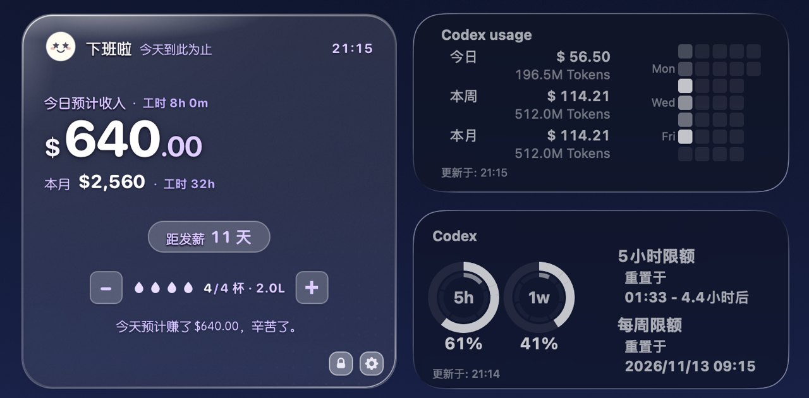
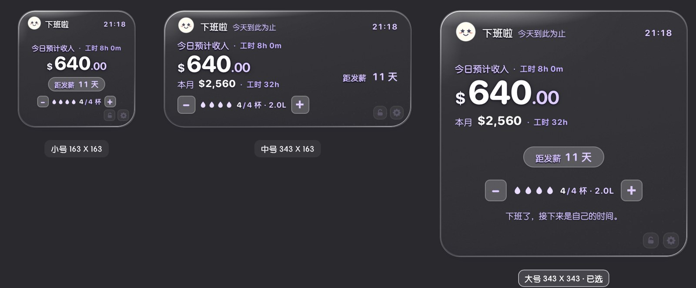
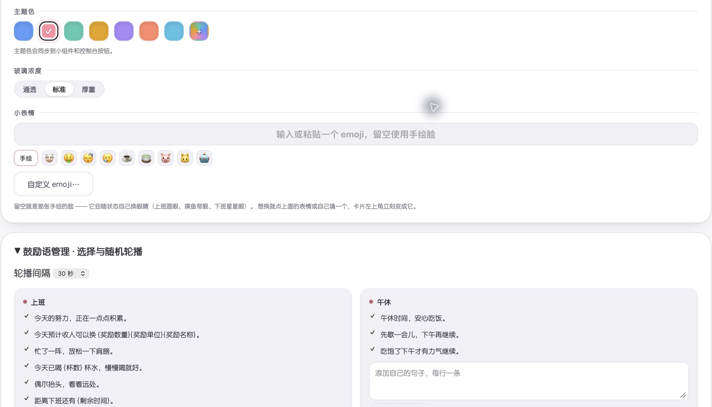

# 牛马鼓励器 · NiuMa Widget

把每天的努力看得见，也把喝水这件小事记下来。

一个贴合 **macOS 原生小组件尺寸与视觉**的桌面伴侣。透明无边框卡片配上液态玻璃风格的高光、细腻边缘与轻磨砂，让壁纸透进来，自然融入桌面。

- **桌面融合感**：小、中、大三档尺寸与桌面小组件网格对齐，自由拖动，锁定后沉到桌面层。
- **液态玻璃质感**：三档玻璃浓度，主题色同步到卡片与控制台，可按壁纸调整。
- **金额实时跳动**：按秒刷新预计收入，随工作时间持续累积，同时显示累计工时、下班倒计时，还能换算成咖啡或午餐等小奖励。
- **贴合自己的节奏**：每周默认排班搭配节假日例外，鼓励语多选随机轮播，自定义 emoji。
- **轻量、离线、本地保存**：Objective-C + WebKit，无第三方依赖，设置和记录保存在本机。

运行平台为 macOS 12+。使用原生 NSPanel 与 WKWebView 实现独立桌面窗口。



透明卡片会透出桌面壁纸，圆角、边缘高光与浅色文字共同形成液态玻璃风格。和其他玻璃风格组件并排摆放时，也能保持协调的桌面观感。

上图为用户提供的桌面实拍，展示大号卡片与其他组件的并排效果，金额和用量为截图当时的数据。

---

## 1.1.0 更新

[下载 macOS 通用版 App](./downloads/NiuMaWidget-macOS-universal.zip)

- 控制台自适应布局，预览采用统一深炭灰背景。
- 鼓励语可按状态多选、添加自定义句子，设置随机轮播间隔。
- 每周上班日长期沿用，节假日和临时改班单独调整，月历批量排班位于折叠的高级入口。
- 收入按薪资与作息生效日期估算，旧版本未留存的历史为推算。
- 喝水区独立放大，支持直接改今日记录、补记历史，按日保存目标和杯容量。
- 新增自定义 emoji 入口、恢复默认撤销与备份导出，保存结果由原生写入回执确认。

通用二进制构建及签名验证通过。新增入口已在实机加载，部分新增功能的完整保存及重启流程仍待验收。

## 它做什么

**打工计价**——只需要填一个薪资，**时薪 / 日薪 / 月薪任选**（填哪个都行，其余自动折算），剩下全部由它推出来：

- 今天预计赚了多少（每秒在跳）、今天已干多久
- 干满一天是多少、本月预计收入与累积工时
- 距下班还有多久、距发薪日还有几天
- 按自定义奖励单价换算咖啡、午餐等数量

**喝水打卡**——`＋ / −` 记一杯，跨天自动归零；控制台里能看到近 14 天的柱状记录（达标实心、未达标淡色、没记录小灰墩），以及有记录天数、日均、总量、达标天数。

**三档尺寸**，和系统桌面小组件落在同一套网格上（窗口 180/360/360，卡片四周各内缩 8.5pt）：

| 尺寸 | 卡片 | 窗口 | 内容 |
|---|---|---|---|
| 小 | 163 × 163 | 180 × 180 | 状态 + 金额 + 倒计时 |
| 中 | 343 × 163 | 360 × 180 | 金额 + 本月 + 倒计时（右栏）+ 喝水 |
| 大 | 343 × 343 | 360 × 360 | 以上全部 + 语录 |




**锁定**——点右下角的锁，卡片沉到桌面图标那一层：所有窗口都在它上面，它不挡任何操作，整张卡片也不再响应点击（只剩锁和齿轮能点）。这样它就更像壁纸的一部分，而不是一个悬浮窗。

---

## 安装

直接使用请下载 [macOS 通用版 App](./downloads/NiuMaWidget-macOS-universal.zip)，解压后打开“牛马鼓励器.app”。支持 Apple Silicon 与 Intel Mac。

自行编译需要 **macOS 12+** 和 Command Line Tools（`xcode-select --install`）。

```bash
git clone https://github.com/TheaXin/niuma-widget.git
cd niuma-widget
./build.sh
open "dist/牛马鼓励器.app"
```

`build.sh` 会编译出 **arm64 + x86_64 通用二进制**，做 ad-hoc 签名，产出 `dist/牛马鼓励器.app`（约 1MB）。没有做公证，首次打开如果被 Gatekeeper 拦下，**右键 → 打开** 一次即可。

程序是 `LSUIElement`，不占 Dock；启动后卡片直接出现在桌面上，位置会记住。

## 使用指南

### 首次设置

1. 打开 App 后，点击卡片右下角齿轮进入控制台。也可通过菜单栏的“打开控制台…”进入。
2. 选择时薪、日薪或月薪，输入薪资参考值，设置上班、下班和午休时间。
3. 勾选每周上班日，此后每周自动沿用。节假日或临时改班在“节假日 / 临时调整”中单独指定。
4. 修改薪资与作息前先选生效日期，确认控制台显示保存成功。需要时点击“保存并重试同步”。
5. 选好小、中、大尺寸，拖动卡片放到桌面合适的位置，再点击锁图标固定。

### 金额如何实时跳动

- App 在运行期间每秒刷新一次，按“折合时薪 × 当天已工作时间”估算收入，金额保留两位小数。
- 日薪按每日净工时折合时薪。月薪再按每周工作日数 × 52/12 折算月均工时。
- 上班前当日金额为零，工作时逐步累积，下班后停留在当天预计总额。
- 开启“午休不计薪”时，符合所设起止范围的午休时间会扣除。休假日不计入工时和预计收入，补班及自定义时段按指定日期处理。
- 跨天后按新日期重新计算。收入属于时间与排班推算，实际出勤、税费、奖金和银行到账需自行核对。

### 锁定位置与桌面操作

| 操作 | 效果 |
|---|---|
| 解锁后拖动卡片 | 调整桌面位置，下次启动还原 |
| 点击锁图标 | 固定位置，卡片沉到桌面层，普通应用窗口可以盖住它 |
| 锁定后点击卡片 | 拖动、喝水加减、双击和右键入口被拦截，避免误触 |
| 锁定后点击齿轮 | 仍可打开控制台修改设置 |
| 再次点击锁图标 | 解锁后恢复拖动与卡片操作 |
| 双击或右键未锁定的卡片 | 打开控制台 |
| 菜单栏图标 | 打开控制台、显示或隐藏卡片、切换尺寸、退出 |

这里的“锁定”指固定桌面位置。系统锁屏展示尚未实现。

### 节假日与临时改班

每周上班日是日常默认。选一个例外日期，再选择休假、补班或自定义时段。已添加的例外会列出来，可修改或删除；删除后该日重新沿用每周设置。

需要批量处理多天时，展开“高级排班 · 月历批量调整”，选择多个日期后应用安排。指定日期的例外优先于每周默认排班。

### 喝水记录

- 在未锁定的小组件上点击 `＋` 记一杯、`−` 撤回一杯。锁定时可先解锁，或打开控制台操作。
- 控制台“喝水记录”可直接输入今日杯数、今日目标、每杯容量，然后点击“保存今日记录”。
- 漏记时展开“补记 / 修改某天喝水”，选日期并填写杯数、当天目标及容量，保存这一天。
- 默认目标和默认容量用于新记录。已有日期保留当天目标和容量，修改默认值不会改写旧记录的升数。
- 跨天显示当天记录，保留最近 180 条日期记录，控制台展示近 14 天概况。

### 自定义外观与鼓励语

选择主题色和玻璃浓度可即时预览。点击“自定义 emoji…”输入或粘贴一个 emoji，留空使用手绘表情。

展开“鼓励语管理”，按上班、午休、下班、开工前、休息日分别勾选句子。自定义内容每行一条，点击“添加并选中”加入；可设置 15 秒、30 秒、1 分钟或 2 分钟轮播。大号卡片从当前状态已选句子中随机播放，避免连续重复。全部取消勾选后，该状态隐藏鼓励语。

### 保存、恢复与备份

设置保存后，以“已保存”回执为准。失败或尚未确认时，保留输入并提示重试。点击“恢复默认”后可在当前控制台撤销；“导出备份”会把已保存的本地状态导出为 JSON 文件。

## 控制台能改什么

- **薪资**：时薪 / 日薪 / 月薪任选一个填，下面一行会写明怎么折算的（月薪 ÷ 上班天数 ÷ 每日工时 → 时薪），改上班时间或每周上班日会自动重算
- **排班**：每周上班日长期沿用；节假日可逐日休假、补班、自定义时段；月历批量调整位于默认折叠的“高级排班”
- **打工参数**：上班/下班时间、午休起止、每周哪几天上班、发薪日、自定义奖励的名称、计量单位和单价
- **外观**：7 个预设主题色 + 任意取色、玻璃三档（通透 / 标准 / 厚重）、小中大三档尺寸
- **小表情**：点击“自定义 emoji…”输入或粘贴一个 emoji，留空则回到手绘的牛马脸（它会随状态自己换眼睛：上班圆眼、摸鱼弯眼、下班星星眼）
- **喝水**：今日杯数、目标和杯容量可直接修改，支持历史补记；默认目标及容量用于新记录
- **文案**：五种状态（上班 / 午休 / 下班 / 开工前 / 休息日）的标题与副标题可改写；鼓励语可多选、自定义多条并随机轮播

主题色由 oklch 色相驱动整套色阶。透明卡片的文字对比度也受壁纸影响，控制台采用统一深色预览背景，方便对照。



## 透明度是怎么做到的

三件事必须同时成立，否则就是「一块灰塑料」：

1. **卡片自己不上色**。`--glass-1/--glass-2` 的 alpha 只有 `.055 / .015`，屏幕上那点颜色 99% 来自壁纸。
2. **原生磨砂层的 alpha 必须极低**。`NSVisualEffectView` 用 `.behindWindow` + `.popover` 材质，材质越不透明越发白 —— `thin` 档压到 `.06`，`thick` 也只到 `.34`。
3. **不要用 `backdrop-filter`**。在透明无边框 WKWebView 里它采不到桌面，只会给卡片糊一层灰膜。

代价是文字必须自己撑住可读性：主文字纯白，次级文字用 oklch `90% .130` 的浅主题色，再加「1px 近描边 + 柔和投影」的文字阴影。

## 技术

```
app/widget.html      卡片本体（小组件加载的页面；？pv=1 可预览，垫一层仿桌面色）
app/dashboard.html   控制台
native/main.m        原生壳：无边框透明 NSPanel / 拖拽 / 尺寸 / 玻璃层 / JS 桥
native/Info.plist    LSUIElement，无 Dock 图标
native/build.sh      clang 直接编译 + 打包 + 签名
design-system/       设计规范：尺寸网格、色阶、阴影、玻璃三档（浏览器直接打开）
```

- 窗口：`NSPanel` + `.borderless` + `.nonactivating`，锁定态把窗口 level 切到 `kCGDesktopIconWindowLevel + 1`，解锁回到 `NSFloatingWindowLevel`
- JS ↔ 原生（`WKScriptMessageHandler`）：`saveConfig` / `adjustWater` / `setWaterDay` / `setLocked` / `exportBackup` / `pullState` / `dragBegin` / `dragEnd` / `openDashboard` / `resize` / `themeChanged` / `quit`
- 状态落盘：`~/Library/Application Support/NiuMaWidget/state.json`，纯 JSON，可以手改
- 计价：`pay()` 一个函数产出「每秒 / 每小时 / 干满一天」三个数，其余全部由它推，不存在第二套口径。日薪/月薪只是**输入层**的换算（`applyPayInput()`），落盘和计算里永远只有 `hourly` 一个基准

调样式时直接开浏览器看卡片，比反复重启 App 快：

```bash
open "app/widget.html?pv=1"                # pv=1 垫一层仿桌面色，否则透明卡片在白底上等于看不见
open "app/widget.html?pv=1&glass=thin&hue=295"   # 玻璃档 / 主题色相
open "app/widget.html?pv=1&state=lunch"    # 只强制状态（打工中/摸鱼中/下班啦/还没开工/休息），数字照常是真帐
open "app/widget.html?pv=1&demo=done"      # demo= 会连金额一起造数，只给设计稿截图用
```


## 已知限制

- 收入是按薪资与排班推算的税前估算，不代表实际到账；旧版本未记录的历史配置无法还原。
- 节假日由用户设置，暂未自动导入各地区法定节假日；月薪折算仍采用平均每月工作周数。
- 喝水保留最近 180 条日期记录，旧记录缺少杯容量时不计入精确升数。
- App 使用 ad-hoc 签名，尚未公证。首次启动请按 macOS 提示处理。
- 部分新增功能的完整保存与重启流程仍待实机验收。

## 后续计划

- [ ] 应用内开机启动开关
- [ ] 可选喝水与起身提醒
- [ ] 喝水数据 CSV 导出

## 许可

[MIT](./LICENSE)。随便改、随便用，改好看了欢迎提 PR。

---

### English

A transparent macOS desktop widget that prices your working day in real time (per-second earnings, countdown to clock-off, monthly total) and tracks daily water intake. Objective-C shell + WebKit front-end, no Xcode project, no web framework, no network access, no third-party dependencies. Build with `./build.sh`, runs on macOS 12+. State lives in `~/Library/Application Support/NiuMaWidget/state.json`. MIT licensed.
