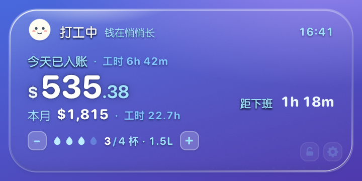
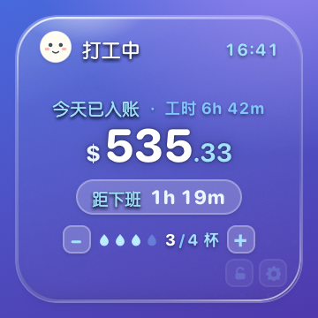
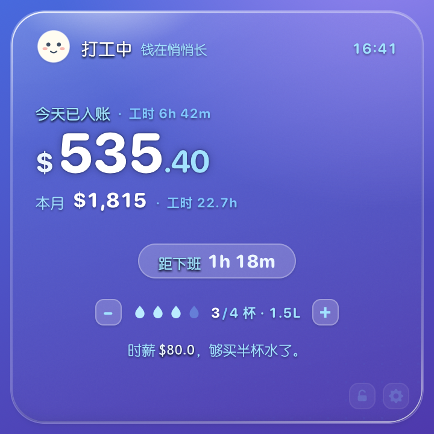

# 牛马鼓励器 · NiuMa Widget

把「今天又赚了多少钱」钉在桌面上，顺手记一下喝水。

一个 macOS 桌面小组件：**透明底、白字、颜色全部来自你的壁纸**，所以它看起来像系统自带的，而不是贴上去的一张图。纯 Objective-C + WebKit，不依赖 Xcode，没有前端框架、没有构建步骤、不联网。



---

## 它做什么

**打工计价**——只需要填一个薪资，**时薪 / 日薪 / 月薪任选**（填哪个都行，其余自动折算），剩下全部由它推出来：

- 今天已经入账多少（每秒在跳）、今天已干多久
- 干满一天是多少、本月累积入账与累积工时
- 距下班还有多久、距发薪日还有几天
- 「时薪 $80，够买半杯奶茶了」这类换算，用来劝自己别加班

**喝水打卡**——`＋ / −` 记一杯，跨天自动归零；控制台里能看到近 14 天的柱状记录（达标实心、未达标淡色、没记录小灰墩、一条虚线标目标），以及有记录天数、日均、总量、达标天数。

**三档尺寸**，和系统桌面小组件落在同一套网格上（窗口 180/360/360，卡片四周各内缩 8.5pt）：

| 尺寸 | 卡片 | 窗口 | 内容 |
|---|---|---|---|
| 小 | 163 × 163 | 180 × 180 | 状态 + 金额 + 倒计时 |
| 中 | 343 × 163 | 360 × 180 | 金额 + 本月 + 倒计时（右栏）+ 喝水 |
| 大 | 343 × 343 | 360 × 360 | 以上全部 + 语录 |

<p>
  
  
</p>

**锁定**——点右下角的锁，卡片沉到桌面图标那一层：所有窗口都在它上面，它不挡任何操作，整张卡片也不再响应点击（只剩锁和齿轮能点）。这样它就更像壁纸的一部分，而不是一个悬浮窗。

---

## 安装

需要 **macOS 12+** 和 Command Line Tools（`xcode-select --install` ≈ 400MB，不需要完整 Xcode）。

```bash
git clone https://github.com/<your-name>/niuma-widget.git
cd niuma-widget
./build.sh
open "dist/牛马鼓励器.app"
```

`build.sh` 会编译出 **arm64 + x86_64 通用二进制**，做 ad-hoc 签名，产出 `dist/牛马鼓励器.app`（约 1MB）。没有做公证，首次打开如果被 Gatekeeper 拦下，**右键 → 打开** 一次即可。

程序是 `LSUIElement`，不占 Dock；启动后卡片直接出现在桌面上，位置会记住。

## 用

| 操作 | 结果 |
|---|---|
| 拖动卡片 | 移动位置，下次启动还原 |
| 双击 / 右键 / 点齿轮 | 打开控制台 |
| 点锁 | 在桌面层与普通窗口层之间切换；锁定时整卡不响应点击 |
| `killall NiuMaWidget` | 退出；也可使用菜单栏的退出选项 |

## 控制台能改什么

- **薪资**：时薪 / 日薪 / 月薪任选一个填，下面一行会写明怎么折算的（月薪 ÷ 上班天数 ÷ 每日工时 → 时薪），改上班时间或每周上班日会自动重算
- **打工参数**：上班/下班时间、午休起止、每周哪几天上班、发薪日、自定义奖励的名称、计量单位和单价
- **外观**：7 个预设主题色 + 任意取色、玻璃三档（通透 / 标准 / 厚重）、小中大三档尺寸
- **小表情**：卡片左上角那张脸可以换成任意 emoji 或一两个字，留空则回到手绘的牛马脸（它会随状态自己换眼睛：上班圆眼、摸鱼弯眼、下班星星眼）
- **喝水**：每天目标杯数、每杯容量（决定「3/4 杯 · 1.5L」里的升数）
- **文案**：三种状态（在岗 / 摸鱼 / 下班）的标题与副标题、语录，全部可改写

主题色是 oklch 的色相一个数字（`--h`）驱动整套色阶，所以换色不会破坏对比度：白色主文字 + 浅主题色次级文字，在任何壁纸上都保持同一套明度关系。


## 透明度是怎么做到的

三件事必须同时成立，否则就是「一块灰塑料」：

1. **卡片自己不上色**。`--glass-1/--glass-2` 的 alpha 只有 `.055 / .015`，屏幕上那点颜色 99% 来自壁纸。
2. **原生磨砂层的 alpha 必须极低**。`NSVisualEffectView` 用 `.behindWindow` + `.popover` 材质，材质越不透明越发白 —— `thin` 档压到 `.06`，`thick` 也只到 `.34`。
3. **不要用 `backdrop-filter`**。在透明无边框 WKWebView 里它采不到桌面，只会给卡片糊一层灰膜。

代价是文字必须自己撑住可读性：主文字纯白，次级文字用 oklch `90% .130` 的浅主题色，再加「1px 近描边 + 柔和投影」的文字阴影。

## 技术

```
app/widget.html      卡片本体（小组件加载的页面；？pv=1 可预览，垫一层仿桌面色）
app/dashboard.html   控制台
native/main.m        原生壳：无边框透明 NSPanel / 拖拽 / 尺寸 / 玻璃层 / JS 桥
native/Info.plist    LSUIElement，无 Dock 图标
native/build.sh      clang 直接编译 + 打包 + 签名
design-system/       设计规范：尺寸网格、色阶、阴影、玻璃三档（浏览器直接打开）
```

- 窗口：`NSPanel` + `.borderless` + `.nonactivating`，锁定态把窗口 level 切到 `kCGDesktopIconWindowLevel + 1`，解锁回到 `NSFloatingWindowLevel`
- JS ↔ 原生（`WKScriptMessageHandler`）：`saveConfig` / `adjustWater` / `setLocked` / `pullState` / `dragBegin` / `dragEnd` / `openDashboard` / `resize` / `themeChanged` / `quit`
- 状态落盘：`~/Library/Application Support/NiuMaWidget/state.json`，纯 JSON，可以手改
- 计价：`pay()` 一个函数产出「每秒 / 每小时 / 干满一天」三个数，其余全部由它推，不存在第二套口径。日薪/月薪只是**输入层**的换算（`applyPayInput()`），落盘和计算里永远只有 `hourly` 一个基准

调样式时直接开浏览器看卡片，比反复重启 App 快：

```bash
open "app/widget.html?pv=1"                # pv=1 垫一层仿桌面色，否则透明卡片在白底上等于看不见
open "app/widget.html?pv=1&glass=thin&hue=295"   # 玻璃档 / 主题色相
open "app/widget.html?pv=1&state=lunch"    # 只强制状态（打工中/摸鱼中/下班啦/还没开工/休息），数字照常是真帐
open "app/widget.html?pv=1&demo=done"      # demo= 会连金额一起造数，只给设计稿截图用
```


## 已知限制

- 只能记当天喝水。漏掉的日子补不回来，记录图里「0 杯」和「没记」是同一个样子
- 计价只按「每周上班日 + 午休」估算，不处理法定节假日、加班、调休；月薪折算按 `每周上班日 × 52/12`（4.33 周/月）算平均上班天数，所以「本月已入账」与真实月薪会有几天出入
- 没有菜单栏入口，退出要 `killall`
- 未签名/未公证，别人的机器上第一次打开要右键 → 打开
- 只在 macOS 上验证过（12 / 14），Windows / Linux 不在范围内

## Roadmap

- [ ] 菜单栏图标：打开控制台 / 退出 / 开机自启
- [ ] 补记喝水（点历史格子改成 N 杯）
- [ ] 节假日日历，让「本月已入账」更准
- [ ] 导出喝水数据 CSV

## 许可

[MIT](./LICENSE)。随便改、随便用，改好看了欢迎提 PR。

---

### English

A transparent macOS desktop widget that prices your working day in real time (per-second earnings, countdown to clock-off, monthly total) and tracks daily water intake. Objective-C shell + WebKit front-end, no Xcode project, no web framework, no network access, no third-party dependencies. Build with `./build.sh`, runs on macOS 12+. State lives in `~/Library/Application Support/NiuMaWidget/state.json`. MIT licensed.
